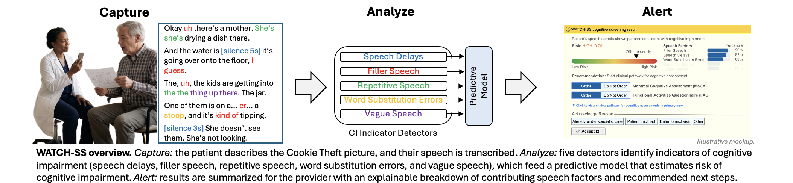
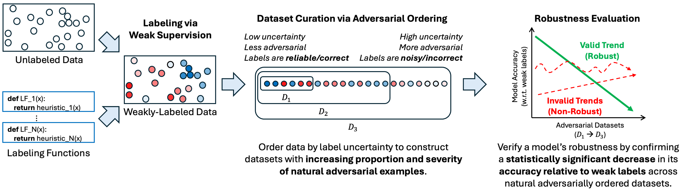
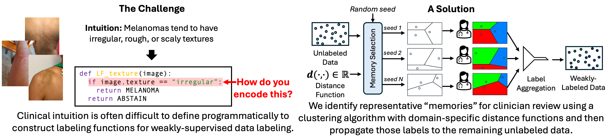

My research focuses on developing trustworthy, explainable AI tools that support clinical decision-making and fit into real clinical workflows. Below is a sample of my current and past projects.

## WATCH-SS (Warning Assessment and Alerting Tool for Cognitive Health from Spontaneous Speech)

Many patients with cognitive impairment go undetected in primary care, where brief and practical screening options are limited. **WATCH-SS** is a brief speech-based screening tool designed to help primary care providers identify patients who may benefit from formal cognitive assessment. Patients describe the Cookie Theft picture, and WATCH-SS analyzes the transcribed speech using five detectors for indicators of cognitive impairment: speech delays, filler speech, repetitive speech, substitution errors, and vague speech. These indicators feed a predictive model that estimates risk of mild cognitive impairment (MCI). Rather than producing a single opaque score, WATCH-SS shows providers which speech factors contributed to a patient’s risk, supporting trust and informed decision-making. Ongoing work focuses on prospective clinical validation and integration into primary care workflows.

[[Paper]](https://doi.org/10.1142/9789819824755_0024) [[Poster]](https://doi.org/10.7490/f1000research.1120305.1) [[Code]](https://github.com/kbjohnson-penn/WATCH-SS)

---

## Evaluating Robustness of Medical AI Systems with Naturally Adversarial Datasets 

To ensure robustness of medical AI systems, we must move beyond unrealistic synthetic perturbations and evaluate against naturally occurring adversarial examples that reflect true healthcare challenges and effectively deceive models. To address this, we developed a weakly-supervised framework that curates **naturally adversarial datasets for evaluating robustness** using existing real-world unlabeled data. Our method first generates probabilistic labels via weak supervision, then orders the examples based on label uncertainty to generate a sequence of datasets that are progressively more adversarial. We can then validate model robustness by confirming a statistically significant decrease in agreement between model predictions and weak labels across the datasets. This trend reflects the expectation that a robust model maintains accuracy on both expected and unexpected inputs, effectively diverging from weak labels as they become unreliable on the unexpected inputs.

[[Paper]](https://doi.org/10.1145/3734695) [[Code]](https://github.com/sfpugh/Naturally-Adversarial-Datasets)

---

## Evaluating Physiologic Monitoring Alarm Suppression Systems with High-Confidence Data Programming

Deploying alarm suppression algorithms requires rigorous validation, yet obtaining the expert-labeled datasets needed to test them is often prohibitively expensive. We introduce a **High-Confidence Data Programming** framework that enables researchers to evaluate classifiers directly on massive unlabeled datasets. By combining clinical heuristics into probabilistic labels and filtering for only the highest-confidence examples, our method generates a '*proxy ground truth*.' This allows us to derive statistical confidence bounds for a model's sensitivity and specificity, providing a reliable performance estimate *without* the need for manual annotation.

[[Paper]](https://dl.acm.org/doi/pdf/10.1145/3549942) [[Code]](https://github.com/sfpugh/Evaluating-Alarm-Classifiers-with-High-Confidence-Data-Programming)

---

## Automating Weak Label Generation for Data Programming with Clinicians in the Loop

Deep learning in healthcare is often stalled by the *data bottleneck*—the prohibitive cost of obtaining expert-annotated large datasets. We propose a clinician-in-the-loop framework that automates weak label generation by identifying the most representative data "memories" in the data using the CLARANS clustering algorithm with domain-specific distance metrics—such as Dynamic Time Warping (DTW) for physiological signals and Kullback-Leibler (KL) divergence of OpenAI's CLIP embeddings for medical images. A clinician then labels these memories, enabling our framework to propagate expert annotations from this small handful of examples to the remaining unlabeled data. This approach significantly reduces manual labeling effort while achieving accuracy comparable to existing weak supervision baselines. 

[[Paper]](https://arxiv.org/pdf/2407.07982)
